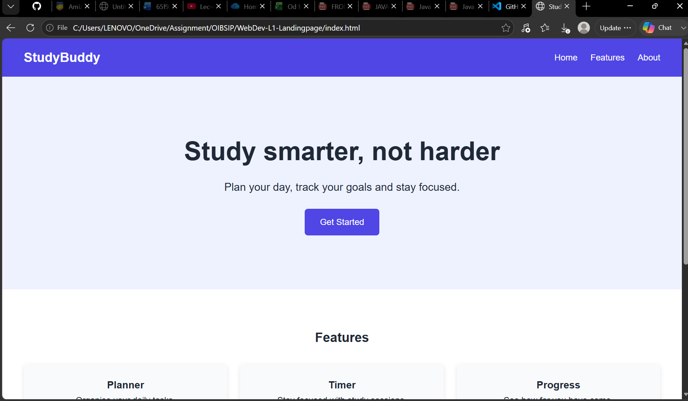
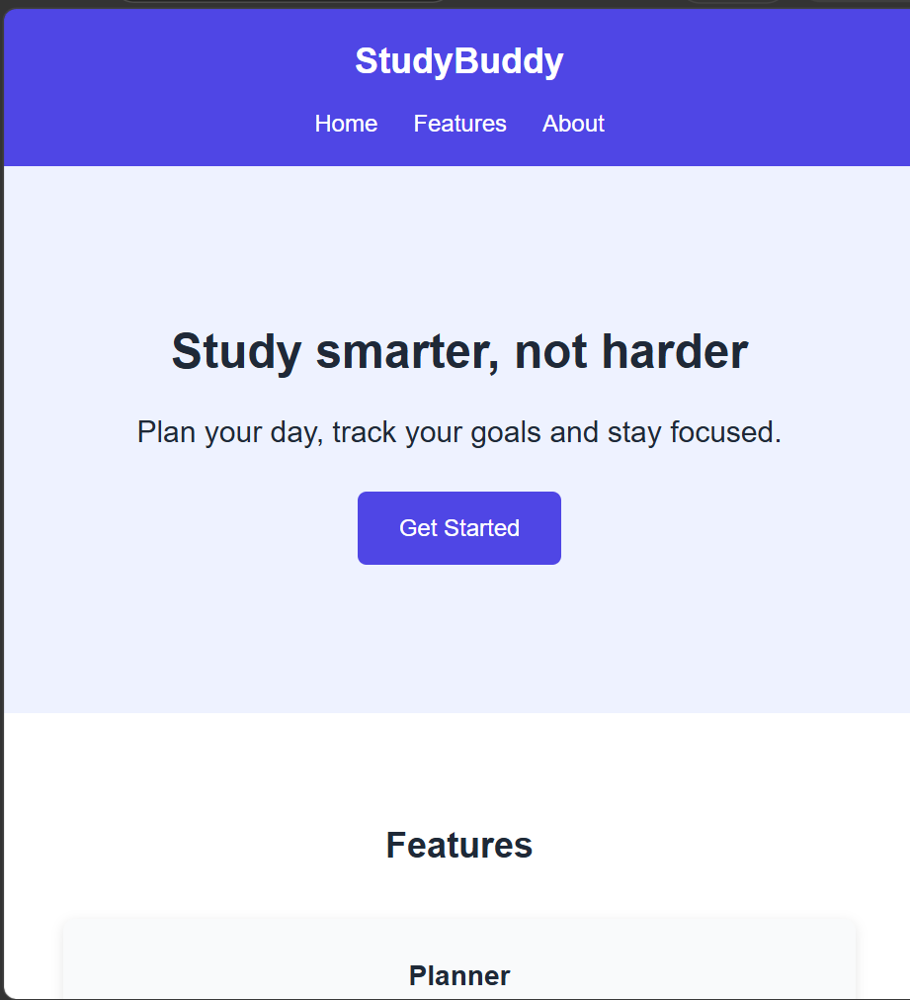

# StudyBuddy Landing Page

A responsive landing page built with HTML5 and CSS3.

## Features
- Sticky navigation bar with 3 links
- Hero section with headline, subheadline and call-to-action
- Features and About sections
- Footer with contact/social placeholders
- Responsive layout using Flexbox and media queries

## Tech Stack
HTML5, CSS3

## How to Run
Open `index.html` in any browser.

## Screenshots
See the `screenshots` folder.
## Screenshots

